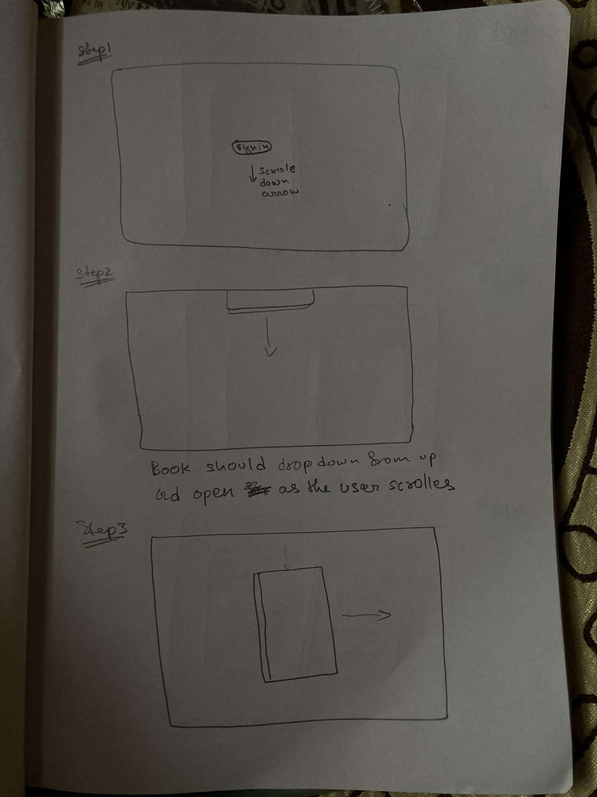
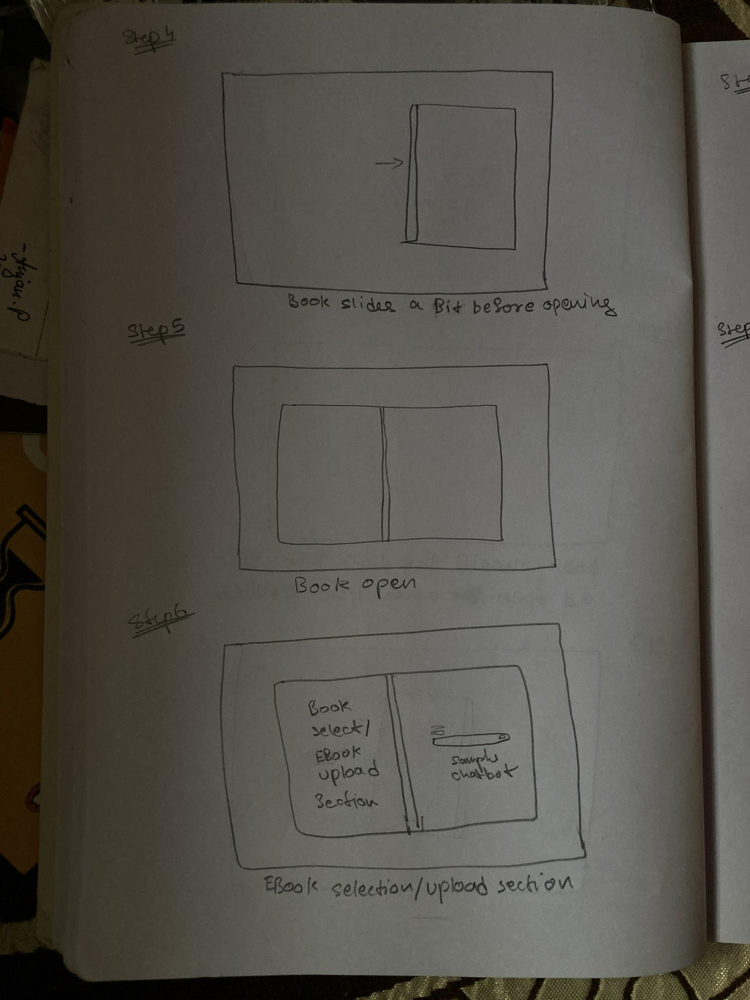
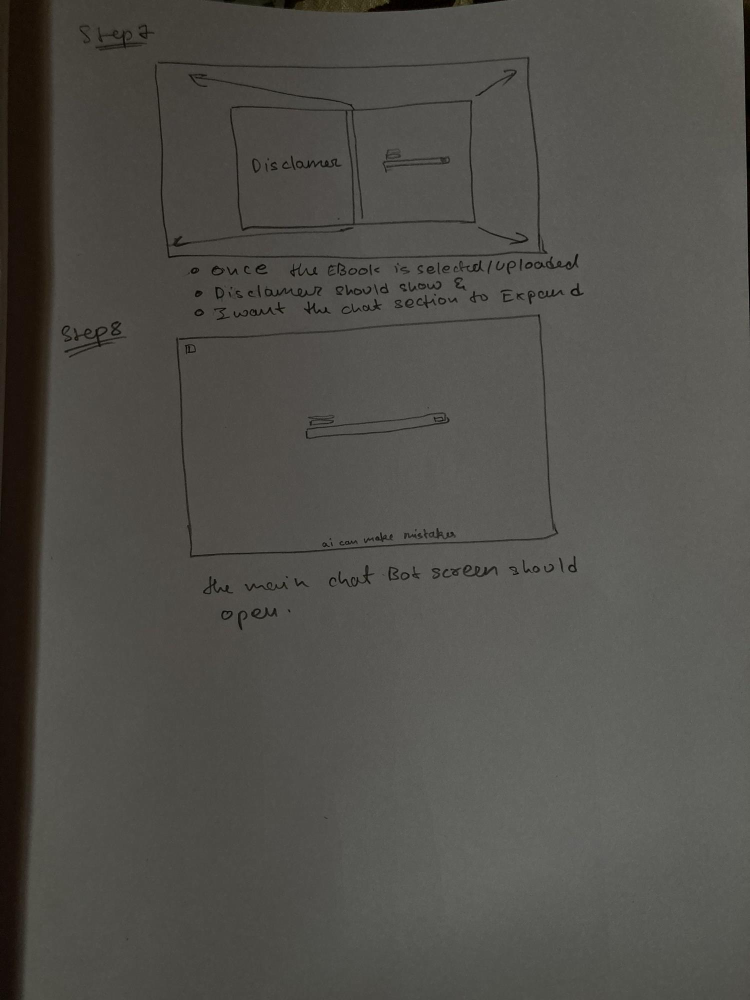

# Ask the Author: Frontend Design

> **Status:** Draft v1 · **Last updated:** 2026-11-18
> **Source:** hand-drawn sketches (steps 1–8) in [`docs/design/sketches/`](design/sketches/)
> **Implementation:** `src/components/landing/*` (steps 1–7), `src/components/chat/*` (step 8)

---

## 1. Concept

The first visit to the site feels like **picking a book up off a table**:
a quiet page with a sign-in button, then, as you scroll, a leather-bound book
drops into view, slides into place, and opens. The open spread holds the
library (left page) and a sample chat (right page). Choosing a book turns the
left page into a disclaimer, and the right page **grows to fill the screen**
and becomes the chat.

| Sketch | |
|---|---|
| Steps 1–3 |  |
| Steps 4–6 |  |
| Steps 7–8 |  |

---

## 2. Step-by-step flow

```mermaid
flowchart LR
    S1["1. Plain screen + Sign in + scroll cue"] -->|scroll| S2["2. Book drops in from the top"]
    S2 --> S3["3. Book lands, centred"]
    S3 --> S4["4. Book slides a bit"]
    S4 --> S5["5. Cover swings open"]
    S5 --> S6["6. Left: choose / upload · Right: sample chat"]
    S6 -->|select or upload| S7["7. Left: disclaimer · Right: chat expands"]
    S7 -->|"I understand"| S8["8. Full chat screen"]
```



| Step | What the user sees | Trigger | Implementation |
|---|---|---|---|
| **1** | Plain paper background, *Ask the Author* title, one-line tagline, **Sign in** button, "Scroll to open the book ↓" cue | Page load | `Hero` in `Landing.tsx`. The cue button smooth-scrolls to step 6. |
| **2** | Hero fades up and away. A closed book drops from above the viewport, tilted slightly. | Scroll 3–30% | `dropY` (with `backOut` easing for a soft landing) + `tilt` (−9° → 0°) |
| **3** | Book settles in the centre of the screen | End of drop | — |
| **4** | Book slides sideways by half a page so the open spread will be centred | Scroll 32–46% | `slide`: `x` from −½ page → 0 |
| **5** | Cover swings open around the spine (3D), with a moving shadow on the page underneath | Scroll 44–70% | `coverAngle`: `rotateY` 0 → −180° (desktop) |
| **6** | **Left page:** book list + upload drop zone. **Right page:** sample Q&A and a chat input. | Scroll 66–76% | `LibraryPage`, `PreviewChatPage`. Pages become clickable at 74%. |
| **7** | Left page changes to the **Disclaimer**. Right page says "ready when you are". On *I understand*, the right page **expands to fill the screen**. | Click a book / drop a file | `DisclaimerPage`, `ExpandToChat` (0.75 s) |
| **8** | Main chat: sidebar icon top-left, centred input, starter questions, "AI can make mistakes" at the bottom | Route `/chat/[bookId]` | `ChatScreen.tsx` |

### Scroll timeline

The landing page is a **460svh-tall** scroll container with a sticky,
full-screen stage. Every animation is driven by `scrollYProgress` (0 → 1),
so scrolling back up plays it in reverse.

```
progress  0      .07   .30  .32     .46       .70   .76            1.0
          |hero--|
          |---drop----------|
                              |--slide--|
                                    |-----open----|
                                                |content|
                                                  ↑ .74 pages interactive
```

---

## 3. Layouts

### Desktop / tablet (≥ 768 px): book opens left ↔ right
- Page size: `min(40vw, 440px)` wide, with a 1 : 1.35 ratio, capped at 80% of the viewport height.
- Open spread: 2 pages wide, centred.

### Mobile (< 768 px): book opens top ↕ bottom
A side-by-side spread would be too narrow on a phone. On mobile the cover
**flips upward** instead (`rotateX` 0 → 180°):
- Top page = library / disclaimer, bottom page = sample chat.
- Each page is 90vw wide and about 43% of the viewport tall. Content scrolls inside the page if needed.

### Reduced motion
If the OS setting *prefers-reduced-motion* is on, the scroll story is skipped.
The page loads with the book already open, and choosing a book goes straight
to the chat without the expand animation.

---

## 4. Screens

### 4.1 Landing hero (step 1)
- Eyebrow: "An AI reading companion"
- Title: **Ask the Author** (serif, 60–96 px)
- Tagline: *"Questions about a book, answered from its pages."*
- **Sign in** pill button that links to `/login`
- Bouncing chevron: "Scroll to open the book"

### 4.2 Book cover
Oxblood leather (CSS gradients + SVG noise), gold double frame, gold serif
title, ornament rules, darker shading along the spine, and stacked page edges
(layered box-shadows) to show the book's thickness.

### 4.3 Left page: Choose a book (step 6)
- Eyebrow "Chapter one", heading "Choose a book"
- Book rows: mini cover swatch, title, author · year, and either an arrow or "Soon"
  - Phase 1: only *Pride and Prejudice* is available
- "or" divider
- **Upload drop zone:** click or drag, EPUB/PDF/TXT, up to 20 MB, personal use only. Validated on the client.

### 4.4 Right page: Sample chat (step 6)
- A sample exchange (*"Why does Mr. Bennet tease his wife so?"*) showing the
  persona name, a **From the book** badge, and a `Ch. 1` citation chip, so the
  core idea is clear before the user does anything.
- A decorative input: "Pick a book to start asking…"
- "AI can make mistakes"

### 4.5 Left page: Disclaimer (step 7)
- "← Back to books"
- Heading **Disclaimer**, with the book title and author
- Four points:
  1. AI simulation of {author}, not the real author (uploads: "AI Book Guide")
  2. Answers come from the book's text and cite the chapter
  3. If the book doesn't say, you'll be told, or it's marked *speculation*
  4. AI can make mistakes. Check the cited passages.
- **Uploads only:** a required checkbox, "I own this copy and I'm uploading it for personal use."
- Primary button: **I understand, open the chat** (starts the expand animation)

### 4.6 Chat screen (step 8)
| Area | Content |
|---|---|
| Top-left | Sidebar toggle icon (the small square in the sketch). Book title appears next to it once the conversation starts. |
| Centre (empty state) | Eyebrow "{Title} · with {Persona}", greeting *"What shall we talk about?"*, **centred input**, starter-question chips |
| Input bar | Left: **reading-progress button** (📖 `Ch. 3`) that opens a spoiler slider: "I've read up to Chapter N". Middle: auto-growing textarea. Right: round send button. |
| After the first question | Messages scroll; the input moves to the bottom |
| Assistant message | Persona name + **answer-mode badge** (From the book / Speculation / Not in the book), serif body text, `[1] Ch. 34` citation chips that expand the quoted passage inline |
| Bottom | "AI simulation of {author}, not the real author · AI can make mistakes. Check the citations." |
| Sidebar (drawer) | New chat · Library · Saved notes (soon) · Conversations (sign in to keep) · Sign in |

> The left-hand icon in the sketched input bar is interpreted as the
> **reading-progress (spoiler) control**. This keeps the screen as minimal as
> the sketch while keeping spoiler control one tap away.

### 4.7 Sign-in (`/login`)
Simple centred card with Google and email magic-link buttons (disabled until
Phase 3), a note that accounts are coming, and "Continue without an account",
which jumps to the open book (`/#library`).

---

## 5. Visual language

| Token | Value | Use |
|---|---|---|
| `paper` | `#f6f1e7` | App background (with faint SVG grain) |
| `page` | `#fbf7ee` | Book pages, popovers |
| `ink` | `#2a221d` | Text, primary buttons |
| `ink-soft` | `#6a5d52` | Secondary text |
| `leather` | `#5e1b1b` | Cover, hover state, citation chips |
| `gold` | `#d1ad63` | Cover title and frame |

- **Type:** *Cormorant Garamond* for headings, persona answers, and quotes (literary feel). *Inter* for UI text, input, and labels.
- **Answer-mode colours:** emerald = from the book, amber = speculation, stone = not in the book.
- **Shape:** pill buttons and inputs, rounded 3xl composer, soft warm shadows.
- **Motion:** scroll-scrubbed for the story, short (150–400 ms) eased transitions for UI, spring for the sidebar.

---

## 6. Components

| Component | File | Notes |
|---|---|---|
| `Landing` | `components/landing/Landing.tsx` | Scroll container, timeline, flow state (`browse → disclaimer → expanding`) |
| `Hero` | same | Step 1 |
| `BookScene` | same | Drop / slide / open; 3D cover + 2D content layer |
| `ExpandToChat` | same | Animates the right page's rect to fill the screen, then routes |
| `BookCover` | `components/landing/BookCover.tsx` | Leather cover |
| `LibraryPage` | `components/landing/LibraryPage.tsx` | Book list + upload |
| `DisclaimerPage` | `components/landing/DisclaimerPage.tsx` | Disclaimer + ownership checkbox |
| `PreviewChatPage` | `components/landing/PreviewChatPage.tsx` | Sample chat |
| `ChatScreen` | `components/chat/ChatScreen.tsx` | Composer, messages, citations, sidebar, spoiler slider |
| `ModeBadge` | `components/chat/ModeBadge.tsx` | Answer-mode badge |
| `useBookDims` | `hooks/useBookDims.ts` | Page size + orientation from the viewport |

**Tech:** Next.js App Router, Tailwind v4, [`motion`](https://motion.dev) (Framer Motion) for `useScroll` / `useTransform`, and `lucide-react` icons.

---

## 7. Accessibility

- Every step is reachable without scrolling precision: the scroll cue button jumps straight to the open book, and `/#library` deep-links there.
- Pages are `inert` and `aria-hidden` until the book is open, so focus can't land on hidden controls.
- Upload drop zone is keyboard-operable (Enter/Space).
- Composer: Enter sends, Shift+Enter adds a new line, and it has a visible label for screen readers.
- Sidebar closes with Esc. Reduced motion is respected (see §3).
- Colour contrast: ink on paper is about 14:1, ink-soft on paper about 5.6:1.

---

## 8. Not wired yet (by design)

| Item | Comes in |
|---|---|
| Real answers, streaming, real citations (`/api/chat`) | Phase 1 |
| Library served from Supabase; real upload + ingest progress | Phase 1–2 |
| Sign-in, saved conversations, saved notes | Phase 3 |

The chat currently returns a **"Design preview"** reply with an example citation so the UI can be reviewed end to end.

---

## 9. Open questions

1. **Sign-in placement after step 1:** should a small "Sign in" link stay visible (top-right) once the book is open, or stay hero-only as sketched?
2. **Disclaimer:** should it be required every time a book is opened, or once per book / per user?
3. **Mobile:** is the upward-flipping book acceptable, or would you prefer a simpler mobile flow, such as the book opening to one page at a time?
4. **Cover art:** one generic *Ask the Author* cover (current), or the selected book's own cover?
